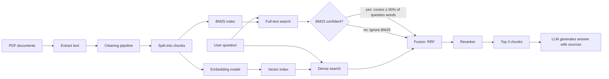
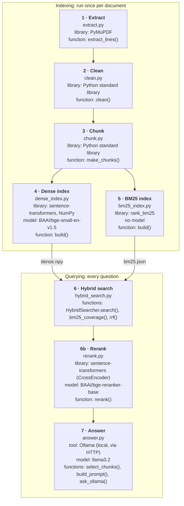

# Hybrid RAG: Dense + Full-Text Search

A simple Retrieval-Augmented Generation (RAG) system that answers employee questions from a company knowledge base. It combines **dense (semantic) search** and **full-text (keyword) search** so it handles both everyday language and exact terms like emails, phone numbers and acronyms.

> Status: ✅ Working end to end, 95% of evaluation questions answered correctly (see [Results](#results))

---

## Why hybrid search?

Each search method fails on different kinds of questions:

| Search type | Good at | Bad at |
|---|---|---|
| **Dense search** (embeddings) | Meaning and paraphrases: *"I saw something shady at work, who do I tell?"* | Exact tokens: `compliance@contoso.com`, `1-800-555-1212`, `PPE` |
| **Full-text search** (BM25) | Exact words, codes, names, acronyms | Synonyms and casual phrasing |
| **Hybrid** (both, fused) | Both | Slightly more complex |

Combining them gives better retrieval than either one alone.

---

## Architecture



---

## Models, libraries and functions

Which tool does the work at each step:



| Step | File | Library | Model | Main function |
|---|---|---|---|---|
| 1 Extract | `extract.py` | PyMuPDF | none | `extract_lines()` |
| 2 Clean | `clean.py` | Python standard library | none | `clean()` |
| 3 Chunk | `chunk.py` | Python standard library | none | `make_chunks()` |
| 4 Dense index | `dense_index.py` | sentence-transformers, NumPy | `BAAI/bge-small-en-v1.5` (embedding, 384 dims) | `build()`, `search()` |
| 5 BM25 index | `bm25_index.py` | rank_bm25 | none (word counting) | `build()`, `BM25Index.search()` |
| 6 Hybrid search | `hybrid_search.py` | (uses steps 4 and 5) | none | `HybridSearcher.search()`, `rrf()` |
| 6b Rerank | `rerank.py` | sentence-transformers `CrossEncoder` | `BAAI/bge-reranker-base` (cross-encoder) | `rerank()` |
| 7 Answer | `answer.py` | Ollama (Python standard library `urllib`) | `llama3.2` (local LLM) | `select_chunks()`, `build_prompt()`, `ask_ollama()` |

Steps 4, 6b and 7 use AI models. All are free and run locally: the embedding model and reranker are downloaded from Hugging Face on first use (~130 MB and ~1.1 GB); the LLM runs in Ollama (`ollama pull llama3.2`, ~2 GB). Nothing is sent to the internet when answering questions.

### Pipeline

**Indexing (done once)**
1. **Load**: read the PDF and extract text.
2. **Clean**: run the automated cleaning pipeline (see [Cleaning pipeline](#cleaning-pipeline)).
3. **Chunk**: split on section and subsection headings, repeating the heading path at the top of each chunk. Merge pieces under 80 words with a neighbour; split pieces over 350 words (~450 tokens) with ~50 words of overlap *inside* the section only.
4. **Index twice**:
   - Dense: embed each chunk and store vectors.
   - Full-text: build a BM25 index over the same chunks.

**Querying (every question)**
1. Run the question through **both** searches (top 10 each).
2. **Confidence check**: if BM25's best chunk contains less than half of the question's words, BM25 is guessing and its list is ignored.
3. **Fuse** the ranked lists with Reciprocal Rank Fusion (RRF).
4. **Rerank** the top 10 with a cross-encoder, which reads the question and each chunk together; keep the top 3.
5. **No-answer check**: if the best reranker score is below 0.002, reply "I couldn't find this in the company documents" without calling the LLM.
6. **Relevance filter**: if the reranker is sure (best score ≥ 0.1), send the LLM only chunks scoring at least 30% of the best score; if it is unsure, send its top 3.
7. LLM answers **only from those chunks**, cites the sources, and says *"I don't know"* if the answer isn't there.

### Fusion method: Reciprocal Rank Fusion (RRF)

Dense and BM25 scores are on different scales, so instead of mixing scores, RRF uses each chunk's **rank**:

```
RRF_score(chunk) = Σ  1 / (k + rank_in_list)      # k = 60 is a common default
```

A chunk ranked high in both lists gets the highest combined score. No score normalization needed.

**Why the BM25 confidence check?** Plain RRF counts every vote equally, even a guessing one. For *"I saw something shady at work, who do I tell?"*, BM25 matched only the word "work", so its list was Workplace Violence, Values, Workplace Safety. Those chunks also appeared low in the dense list, so RRF treated them as "both searches agree" and put **Workplace Safety** first, above the correct **Reporting Procedures** (dense rank 1). Ignoring BM25 when its best chunk covers under 50% of the question words fixes this, while keeping BM25's vote for exact terms like `1-800-555-1212` (100% coverage).

### Reranking

Dense search and BM25 never read the question and a chunk **together**, which makes them fast but rough. A reranker (cross-encoder) reads each (question, chunk) pair and scores how well the chunk answers the question. It is too slow for every chunk, so it only re-sorts the ~10 candidates from hybrid search.

### Model input limits and chunk size

Every model can read only a limited amount of text at once, measured in **tokens** (pieces of words). A token is not a word: common words are one token, but rare words, numbers and emails are split into several (`1-800-555-1212` and `compliance@contoso.com` take many tokens). In English, **1 word ≈ 1.3 tokens**.

**The catch: text over the limit is cut off silently.** The model reads the first N tokens and ignores the rest, with no error or warning. If the answer is at the end of a long chunk (for example the hotline number in the last sentence), the model never sees it, the chunk is ranked lower, and nothing tells you why.

| Model | Limit | What must fit inside the limit |
|---|---|---|
| Embedding `BAAI/bge-small-en-v1.5` | 512 tokens | The chunk alone (the question is embedded separately) |
| Reranker `BAAI/bge-reranker-base` | 512 tokens | **The question + the chunk together**, so a long question leaves less room for the chunk |
| LLM `llama3.2` in Ollama | Ollama's context window (smaller by default than the model's maximum; set with the `num_ctx` option) | Instructions + all chunks sent + the question |

The **reranker is the tightest limit** in this pipeline, so it decides the chunk size. Limits are listed on each model's page (its "model card") on [Hugging Face](https://huggingface.co).

How this project handles it:
- **Chunk size is set to fit**: `MAX_WORDS = 350` in `chunk.py` (≈ 450 tokens). The longest real chunk is 280 words (≈ 360 tokens), leaving room for the question in the reranker.
- **Model chosen for the limit**: the first embedding model, `all-MiniLM-L6-v2`, reads only **256** tokens and would have cut the longest chunks; `bge-small-en-v1.5` reads 512.
- **Heading path at the top of every chunk**: if anything is cut, it's the end, never the heading, so the model always knows the chunk's topic.
- **Warning at build time**: `dense_index.py build` counts each chunk's tokens and prints a `WARNING` if one is too long for the embedding model.
- **Small LLM prompts**: at most 3 chunks (≈ 1,200 tokens) are sent to the LLM.

Known gap: the reranker has **no length warning yet**. With these chunks and short questions it is safe, but with new documents (longer chunks) or long questions, the end of a chunk could be cut without notice. For new documents, lowering `MAX_WORDS` to about 300 gives a safety margin.

---

## Cleaning pipeline

With many documents, cleaning can't be done by hand. It's a set of **automated rules** that run on every document, improved over time based on which evaluation questions fail.

**Principles**
- Never change the meaning of the text, only its form.
- Keep the raw extracted text, so cleaning can be re-run or debugged.
- Log what each step removed, per document.

### Steps (in order)

| # | Step | What it does | Why it matters | Built? |
|---|---|---|---|---|
| 1 | **Layout-aware extraction** | Keep font size and bold for every line (PyMuPDF), so headings can be found | Plain text extraction loses the heading clues | ✅ `extract.py` |
| 2 | **Normalize text** | Unicode normalization (NFKC), standardize quotes/dashes, collapse extra whitespace | Same word always looks the same to BM25 | ✅ |
| 3 | **Fix line breaks** | Rejoin lines into paragraphs, keep hyphens at line ends (`cutting-` + `edge` → `cutting-edge`), use blank lines as paragraph breaks | BM25 can match whole words; headings are detectable for chunking | ✅ |
| 4 | **Remove boilerplate** | Drop lines repeated on most pages (headers, footers, page numbers) and known disclaimers | Stops noise from polluting search results | ✅ |
| 5 | **Deduplicate** | Remove repeated paragraphs (exact match after lowercasing) | Duplicates crowd the top-k results in both searches | ✅ exact only; near-duplicates (MinHash) not yet |
| 6 | **Handle versions** | Save the "Last Updated" date as metadata | Lets you prefer the newest policy | ✅ date saved; choosing the newest version not yet |
| 7 | **Detect structure** | Mark headings (font size), subheadings (short line, no full stop) and list items | Needed for section-based chunking | ✅ |
| 8 | **Merge small pieces, filter junk** *(during chunking)* | Merge subsections under 80 words with a neighbour; drop only near-empty chunks (under 5 words) | Keeps short but real answers (e.g. one-sentence "Confidentiality") instead of deleting them | ✅ `chunk.py` |

### Issues found in the Contoso handbook

| Issue | Example | Fixed by step |
|---|---|---|
| Heading glued to previous text | `...roles.Workplace Safety` | 3 |
| Word lost its hyphen | `cuttingedge` | 1, 3 |
| Duplicate paragraph | Intro text = "Our Mission" text | 5 |
| List broken across pages | `Director of Human Resources15. Director of...` | 1, 7 |
| Disclaimer on title page | "This document contains information generated using a language model..." | 4 |

### Quality check
1. Spot-check a random sample of documents by printing their chunks.
2. Run the evaluation questions.
3. For every wrong answer caused by dirty text, add or adjust a rule, then re-run the pipeline on all documents.

---

## Tech stack

| Component | Choice | Notes |
|---|---|---|
| Language | Python 3.10+ | |
| PDF parsing | `PyMuPDF` (or Docling) | Layout-aware, keeps headings and lists |
| Cleaning | Python standard library | Exact duplicate removal by text hash; `datasketch` (MinHash) could add near-duplicate detection later |
| Embeddings | `sentence-transformers` with `BAAI/bge-small-en-v1.5` | Free, runs locally, 512-token limit |
| Vector store | NumPy file (FAISS or ChromaDB at larger scale) | |
| Full-text search | `rank_bm25` | |
| Fusion | Custom RRF function + BM25 confidence check | ~10 lines of code |
| Reranker | `sentence-transformers` CrossEncoder with `BAAI/bge-reranker-base` | Free, runs locally |
| LLM | `llama3.2` in Ollama, local | Swappable: change `MODEL` in `answer.py` |

---

## Dataset

**Contoso Electronics Employee Handbook**: a fictitious company handbook from Microsoft's [azure-search-openai-demo](https://github.com/Azure-Samples/azure-search-openai-demo) sample (`data/` folder).

Sections: Mission, Values, Performance Reviews, Workplace Safety, Workplace Violence, Privacy, Whistleblower Policy, Data Security, Job Roles.

> **Note:** The PDF states "All rights reserved to Microsoft". Link to the original source instead of committing the PDF to this repo.

---

## Evaluation plan

The system is tested with six question types. Each targets a different weakness.

| # | Type | What it tests | Example | Expected answer |
|---|---|---|---|---|
| 1 | **Everyday language** | Dense search | How often will my boss check how I'm doing? | Annually, in a performance review with the supervisor |
| 2 | **Exact document terms** | Full-text search | What is 1-800-555-1212? | The Compliance Hotline (also for anonymous reports) |
| 3 | **Mixed** (casual + exact term) | Hybrid search | Can someone get fired for getting back at me after I use the Whistleblower Policy? | Yes, retaliation can lead to termination |
| 4 | **Strict document language** | Full, accurate retrieval | What is the definition of Workplace Violence? | Physical aggression, intimidation or threats, incl. assault, verbal abuse, harassment, bullying, stalking |
| 5 | **Unanswerable** | No hallucination | How many vacation days do I get? | "Not found in the documents" |
| 6 | **Multi-section** | Combining several chunks | Which policies also apply to contractors? | Privacy Policy and Whistleblower Policy |

The full set is `eval/questions.csv`: 22 questions (4 per type, 2 multi-section), each with the chunk(s) that contain the answer and the facts the answer must include. Every expected fact was checked to really appear in its expected chunk.

### Running the evaluation

```bash
python eval/run_eval.py             # retrieval + "no answer" check (no LLM, about a minute)
python eval/run_eval.py --answers   # also asks Ollama all 22 questions and checks the answers
```

### Metrics
- **Hit@1 / Hit@3**: is a correct chunk ranked 1st / in the top 3? Measured for five methods, to see what each part adds: Dense, BM25, plain RRF, Hybrid (RRF + BM25 confidence check), and Hybrid + Rerank.
- **All needed chunks in top 3**: for questions whose answer spans 2+ chunks.
- **"No answer" check**: does the reranker-score cut-off skip the LLM exactly for the questions the handbook can't answer?
- **Answer check** (`--answers`): does the answer contain every expected fact (`a;b|c` = a AND (b OR c)), or refuse when it should?

Results per question are saved to `eval/results.csv`.

### Results

**Final: 21 / 22 answers correct (95%)** with llama3.2, after tuning from three evaluation runs:

| Run | Change | Answers correct | Answerable questions wrongly skipped |
|---|---|---|---|
| 1 | Starting settings (`NO_ANSWER_SCORE = 0.01`) | 91% | 1 |
| 2 | `NO_ANSWER_SCORE` 0.01 → 0.002 | 91% | 0 |
| 3 | Added `UNSURE_SCORE` (no filtering when the reranker is unsure) | **95%** | 0 |

Retrieval in detail (identical in all runs; the changes only affected which chunks reach the LLM). Correct chunk in the top 3 for every answerable question (Dense, RRF, Hybrid, +Rerank).

| Hit@1 (correct chunk ranked 1st) | n | Dense | BM25 | RRF | Hybrid | +Rerank |
|---|---|---|---|---|---|---|
| 1 Everyday | 4 | 75% | 25% | 50% | 75% | 50% |
| 2 Exact term | 4 | 75% | 100% | 75% | 75% | 75% |
| 3 Mixed | 4 | 100% | 75% | 75% | 100% | 100% |
| 4 Strict | 4 | 100% | 100% | 100% | 100% | 100% |
| **All answerable** | 19 | **89%** | 79% | 79% | **89%** | 84% |

| All needed chunks in top 3 (answers spanning 2+ chunks) | Dense | BM25 | RRF | Hybrid | +Rerank |
|---|---|---|---|---|---|
| 3 questions | 33% | 67% | 67% | 67% | **100%** |

What this shows:
- **BM25 confidence check proven**: Hybrid beats plain RRF (89% vs 79% Hit@1; 75% vs 50% on everyday questions).
- **The two searches complement each other**: BM25 is perfect on exact terms (100%) but weak on everyday language (25%).
- **Reranker**: the only method that finds *all* chunks for multi-chunk answers (100%), but slightly less sure on casual wording (everyday Hit@1 50%).
- **"No answer" cut-off**: unanswerable questions scored 0.0000, 0.0005, 0.0050; an answerable casual question ("How often will my boss check how I'm doing?") scored 0.0066 and was wrongly skipped at 0.01. Lowered to 0.002: skipping a real answer is worse than one extra LLM call, and the LLM refused correctly on the trick question "Which month are performance reviews held?".
- **Reranker + filter**: for *"How often will my boss check how I'm doing?"* the reranker ranked Job Roles 1st, and the 30% filter removed the right chunk (Performance Reviews, 2nd). Not filtering when the reranker is unsure fixed it (run 3), without breaking the other casual or unanswerable questions.
- **Known limitation**: for `compliance@contoso.com` the answer is correct ("the email for reporting compliance concerns") but doesn't name the Compliance Officer; llama3.2 tends to give the shortest possible answer. A larger model is the next thing to try.

---

## Quick start

On a Mac, use `python3` and `python3 -m pip` instead of `python` and `pip`.

```bash
pip install -r requirements.txt
# put employee_handbook.pdf in data/ (download link under Dataset)
python src/extract.py data/employee_handbook.pdf      # -> output/employee_handbook.raw.json
python src/clean.py output/employee_handbook.raw.json # -> .clean.json, .clean.md, .clean_log.txt
python src/chunk.py output/employee_handbook.clean.json # -> .chunks.json, .chunks.md
```

Open `output/employee_handbook.clean.md` to spot-check the cleaned text, `clean_log.txt` to see what was removed, and `chunks.md` to read every chunk.

**Chunking rules** (settings at the top of `chunk.py`):
- One chunk per subsection; every chunk starts with its heading path (`Whistleblower Policy > Reporting Procedures`).
- Lists are never cut, and stay with the sentence that introduces them.
- Subsections under 80 words are merged with a neighbour in the same section, never deleted.
- Groups over 350 words (~450 tokens) are split, repeating the last paragraph (~50 words) as overlap.

Result on the Contoso handbook: 14 chunks, 85–280 words each.

**Dense search** (Step 4):

```bash
python src/dense_index.py build output/employee_handbook.chunks.json
python src/dense_index.py search output/employee_handbook.chunks.json "I saw something shady at work, who do I tell?"
```

- Model: `BAAI/bge-small-en-v1.5` (384 numbers per vector, reads up to 512 tokens, runs on CPU). Downloaded on first run.
- Vectors are normalized, so similarity is a simple dot product (cosine similarity).
- Vectors are stored in a NumPy file. That's plenty for thousands of chunks; switch to FAISS or a vector database at much larger scale.
- `build` warns if any chunk is longer than the model can read.

**Keyword search** (Step 5):

```bash
python src/bm25_index.py build output/employee_handbook.chunks.json
python src/bm25_index.py search output/employee_handbook.chunks.json "What is 1-800-555-1212?"
```

- Library: `rank_bm25` (BM25Okapi, default k1=1.5, b=0.75). No model, no vectors.
- Tokenizer keeps emails, phone numbers and hyphenated words whole **and** adds their parts (`compliance@contoso.com` → `compliance@contoso.com`, `compliance`, `contoso`, `com`).
- Common words (the, is, what...) are removed.
- Search output shows which question words matched each chunk.

**Hybrid search and reranking** (Steps 6 and 6b), after building both indexes:

```bash
python src/hybrid_search.py output/employee_handbook.chunks.json "I saw something shady at work, who do I tell?"
python src/hybrid_search.py output/employee_handbook.chunks.json "What is 1-800-555-1212?" --rerank
```

The output shows every stage: dense list, BM25 list (with its coverage and whether it was used), the RRF result, and, with `--rerank`, the reranked top 3. Settings (`RRF_K`, `CANDIDATES`, `MIN_BM25_COVERAGE`, `RERANK_TOP_N`) are at the top of `hybrid_search.py`.

**Answering** (Step 7), with Ollama running and `ollama pull llama3.2` done:

```bash
# chat mode: models load once, then type questions (type 'quit' to stop)
python src/answer.py output/employee_handbook.chunks.json

# or a single question
python src/answer.py output/employee_handbook.chunks.json "I saw something shady at work, who do I tell?"
```

Reranker scores measured on the handbook, which set the two thresholds in `answer.py`:

| Question | Answer in handbook? | Best reranker score |
|---|---|---|
| What is 1-800-555-1212? | Yes, exact | 0.990 |
| I saw something shady at work, who do I tell? | Yes, different wording | 0.054 |
| How many vacation days do I get? | No | 0.000 |

- `NO_ANSWER_SCORE = 0.002`: below this, the LLM is not called. (Started at 0.01; the evaluation showed that wrongly skipped an answerable question, see Results.)
- `KEEP_RELATIVE = 0.3`: chunks under 30% of the best score are dropped (they were 0.000–0.006 here)...
- `UNSURE_SCORE = 0.1`: ...but only when the reranker is sure. Below 0.1 (casual wording) its #1 can be wrong, so its whole top 3 goes to the LLM. Found by the evaluation: for *"How often will my boss check how I'm doing?"* the reranker ranked Job Roles 1st and Performance Reviews 2nd, and the filter removed the right chunk.

---

## Project structure

```
hybrid-rag/
├── README.md
├── requirements.txt
├── data/                  # PDFs (not committed, see Dataset)
├── output/                # generated files (not committed)
├── src/
│   ├── extract.py         # PDF → raw text
│   ├── clean.py           # cleaning pipeline (steps 2–7)
│   ├── chunk.py           # section-based chunking + junk filter
│   ├── dense_index.py     # embeddings + vector store
│   ├── bm25_index.py      # full-text index
│   ├── hybrid_search.py   # confidence check + RRF fusion
│   ├── rerank.py          # cross-encoder reranker
│   └── answer.py          # no-answer check + prompt + local LLM (Ollama)
└── eval/
    ├── questions.csv      # 22 test questions + expected chunks and facts
    ├── run_eval.py        # scores dense / BM25 / RRF / hybrid / reranked (+ answers)
    └── results.csv        # written by run_eval.py
```

---

## Roadmap

- [x] Extract text from the Contoso handbook
- [x] Build the cleaning pipeline (normalize, fix line breaks, boilerplate, dedup)
- [x] Section-based chunking with heading paths and junk filter
- [x] Spot-check chunks
- [x] Build dense search
- [x] Build BM25 search
- [x] Implement RRF fusion (with BM25 confidence check)
- [x] Add a reranker
- [x] Add LLM answer generation with source citations (Ollama, local)
- [x] Create evaluation set (6 question types, 22 questions)
- [x] Evaluation script (dense vs BM25 vs RRF vs hybrid vs reranked, no-answer check, answers)
- [x] Run the evaluation and record results
- [x] Tune `NO_ANSWER_SCORE` from the results (0.01 → 0.002)
- [x] Second run: 0 answerable questions skipped; LLM refused the salary trick question correctly. Found the reranker + filter dropping the right chunk for a casual question → added `UNSURE_SCORE`
- [x] Third run with `UNSURE_SCORE`: 95% (21/22)
- [ ] Try a larger Ollama model (e.g. `llama3.1:8b`) and compare
- [ ] Add a length warning for the reranker (question + chunk over 512 tokens)
- [ ] (Later) Add more documents and a simple chat UI

---

## Lessons learned

- **Check every model's input limit against your chunk size.** Text over the limit is cut off silently. `all-MiniLM-L6-v2` reads only 256 tokens; our longest chunks are ~360, so their ends would never be searched. Switched to `bge-small-en-v1.5` (512 tokens). The reranker must fit the question *and* the chunk in its 512 tokens, which makes it the tightest limit (see [Model input limits](#model-input-limits-and-chunk-size)).
- **Don't delete short chunks; merge them.** A "drop chunks under 30 words" rule would have deleted the one-sentence *Confidentiality* rule. Merging with neighbours keeps it.
- **Plain RRF can be fooled by a guessing search.** BM25 matching only "work" pushed the wrong chunks to the top. Measuring how much of the question BM25 actually matched, and ignoring it below 50%, fixed it.
- **Use reranker scores relatively, not absolutely.** A correct answer in casual wording scored only 0.054, an exact match 0.990, no answer 0.000. A fixed "keep above 0.1" rule would have dropped the correct casual answer; "keep above 30% of the best" works for both.
- **A score cut-off can't always separate "answer" from "no answer".** An answerable casual question (0.0066) scored almost the same as an unanswerable one (0.0050). Set the cut-off on the side of the cheaper mistake, and let the LLM's instructions be the second safety net.
- **Debug a pipeline layer by layer.** Fixing the cut-off let the question reach the LLM, which then said "I don't know". Checking what the LLM had received (`eval/results.csv`) showed the reranker had put the wrong chunk first. The LLM was right given its input; the fix belonged two steps earlier.
- **Test each step on real questions before adding the next.** Each of these lessons was found that way.
